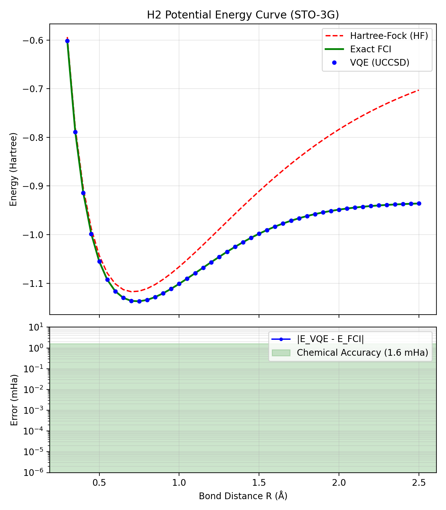
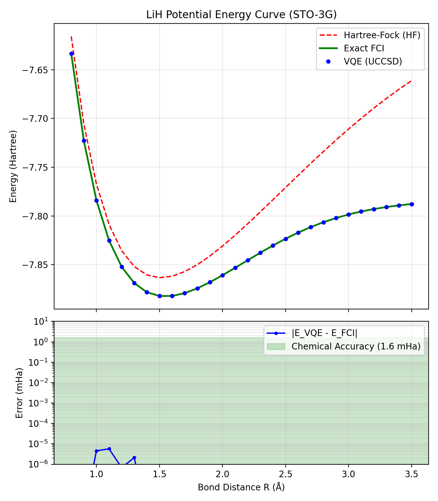
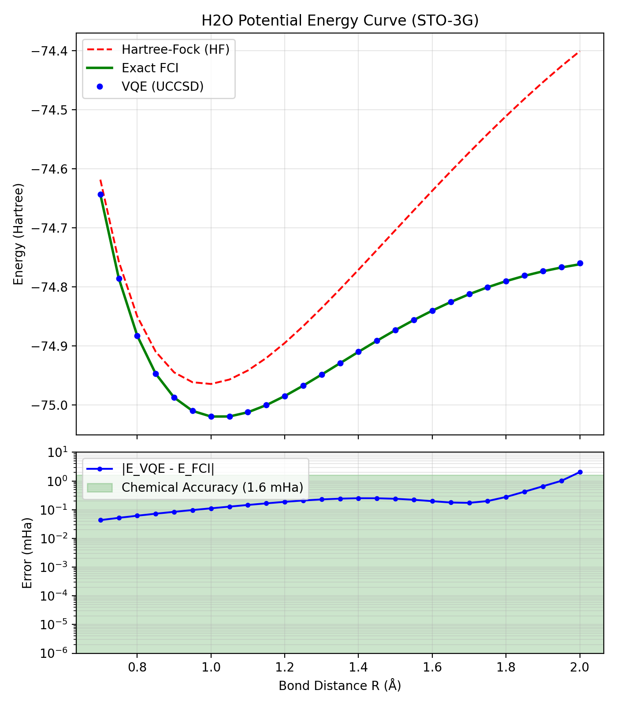
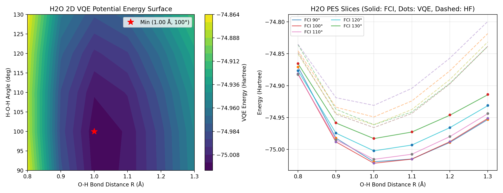
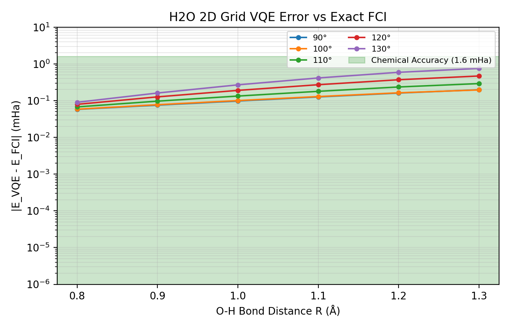
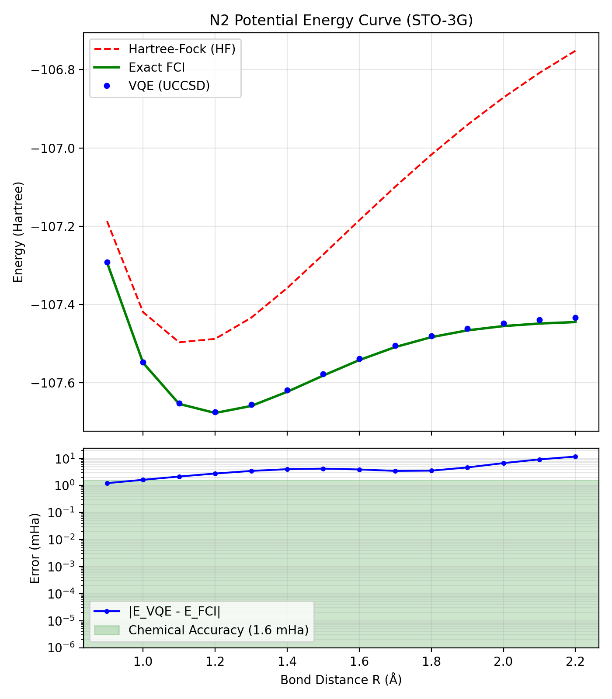

# Variational Quantum Eigensolver (VQE) for Molecular Chemistry

Exact classical CPU simulation of the **Variational Quantum Eigensolver (VQE)** with a spin-conserving **UCCSD** ansatz across $\text{H}_2$, $\text{LiH}$, $\text{H}_2\text{O}$, and $\text{N}_2$ (4 to 16 qubits), benchmarked against exact active-space Full Configuration Interaction (**FCI** via PySCF CASCI).

---

## Headline Summary

### Reference Single-Geometry Benchmarks

| Molecule | Geometry | Qubits | Sector Dim | Pauli Terms | UCCSD Params | Iterations | Wall Time (s) | $E_{\text{HF}}$ (Ha) | $E_{\text{VQE}}$ (Ha) | $E_{\text{FCI}}$ (Ha) | Error (mHa) |
|---|---|:---:|:---:|:---:|:---:|:---:|:---:|:---:|:---:|:---:|:---:|
| **$\text{H}_2$** | $R = 0.735\text{ \AA}$ | 4 | 4 | 15 | 2 | 3 | 0.15 | -1.11699900 | -1.13730604 | -1.13730604 | $8.88 \times 10^{-10}$ |
| **$\text{LiH}$** | $R = 1.600\text{ \AA}$ | 10 | 25 | 276 | 14 | 10 | 0.85 | -7.86186477 | -7.88209660 | -7.88209660 | $5.91 \times 10^{-6}$ |
| **$\text{H}_2\text{O}$** | $R = 0.960\text{ \AA}, 104.5^\circ$ | 12 | 225 | 551 | 44 | 11 | 5.95 | -74.96331905 | -75.01297675 | -75.01307689 | 0.1001 |
| **$\text{N}_2$** | $R = 1.098\text{ \AA}$ | 16 | 3,136 | 1,177 | 135 | 12 | 34.19 | -107.49597503 | -107.65056190 | -107.65270379 | 2.1419 |

### Potential Energy Surface (PES) Sweeps

| Molecule | Scan Range | Points | Gradient Method | Equilibrium Found (VQE & FCI) | Mean Error (mHa) | Max Error (mHa) | Total Wall Time (s) |
|---|---|---:|---|---|---:|---:|---:|
| **$\text{H}_2$** | $R \in [0.30, 2.50]\text{ \AA}$, $\Delta R = 0.05\text{ \AA}$ | 45 | Finite Difference | $R = 0.75\text{ \AA}$ (`-1.13711707 Ha`) | 0.0000 | 0.0000 | 5.38 |
| **$\text{LiH}$** | $R \in [0.80, 3.50]\text{ \AA}$, $\Delta R = 0.10\text{ \AA}$ | 28 | Finite Difference | $R = 1.50\text{ \AA}$ (`-7.88213996 Ha`) | 0.0000 | 0.0000 | 28.42 |
| **$\text{H}_2\text{O}$ (1D)** | $R \in [0.70, 2.00]\text{ \AA}$, $\Delta R = 0.05\text{ \AA}$, $104.5^\circ$ | 27 | JAX Autodiff | $R = 1.00\text{ \AA}$ (`-75.01966989 Ha`) | 0.2950 | 2.0449 | 126.93 |
| **$\text{H}_2\text{O}$ (2D)** | $R \in [0.80, 1.30]\text{ \AA}$, $\theta \in [90^\circ, 130^\circ]$ | 30 | JAX Autodiff | $R = 1.00\text{ \AA}, 100^\circ$ (`-75.02146685 Ha`) | 0.2073 | 0.7527 | 138.24 |
| **$\text{N}_2$** | $R \in [0.90, 2.20]\text{ \AA}$, $\Delta R = 0.10\text{ \AA}$ | 14 | Sparse Adjoint | $R = 1.20\text{ \AA}$ (`-107.67429959 Ha`) | 4.5045 | 11.8024 | 444.70 |

---

## Potential Energy Curves & Error Plots

### $\text{H}_2$ and $\text{LiH}$ Dissociation Curves
| $\text{H}_2$ (4 qubits) | $\text{LiH}$ (10 qubits) |
|---|---|
|  |  |

### $\text{H}_2\text{O}$ 1D Stretch & 2D Bond-Angle Surface (12 qubits)
| $\text{H}_2\text{O}$ Symmetric Stretch | $\text{H}_2\text{O}$ 2D PES | $\text{H}_2\text{O}$ 2D Error |
|---|---|---|
|  |  |  |

### $\text{N}_2$ Triple-Bond Dissociation Curve (16 qubits)


> See [`results/NOTES.md`](results/NOTES.md) for detailed observations on $\text{N}_2$ static correlation and the sparse adjoint gradient solver.

---

## How VQE Works

The **Variational Quantum Eigensolver (VQE)** is a hybrid quantum-classical algorithm that finds an upper bound to the ground-state energy $E_0$ of a molecular Hamiltonian $H$ via the Rayleigh-Ritz variational principle:

$$E(\theta) = \langle \psi(\theta) | H | \psi(\theta) \rangle \ge E_0$$

1. **Molecular Hamiltonian**: One- and two-electron integrals are computed with PySCF (STO-3G basis, frozen core orbitals) and mapped from fermionic operators to qubit operators via the Jordan-Wigner transformation in OpenFermion.
2. **UCCSD Ansatz**: A spin-conserving Unitary Coupled Cluster Singles and Doubles state $|\psi(\theta)\rangle = \exp(G(\theta))|\text{HF}\rangle$ is prepared from anti-Hermitian excitation generators $G(\theta) = \sum_k \theta_k (T_k - T_k^\dagger)$, initialized at $\theta = 0$ (the Hartree-Fock state).
3. **Classical Optimization**: `L-BFGS-B` minimizes $E(\theta)$ using finite-difference gradients ($\text{H}_2$, $\text{LiH}$), cached JAX autodiff ($\text{H}_2\text{O}$), or a sparse Duhamel/adjoint gradient ($\text{N}_2$). Geometry scans warm-start each point from the previous optimum and checkpoint after every geometry.

---

## Why Sparse Particle-Number-Restricted Simulation Fits This Problem Size

In the full $N$-qubit Hilbert space, operator dimension scales as $2^N$:
- For $\text{N}_2$ (16 qubits), the full space is $2^{16} = 65,536$-dimensional, and a dense matrix would require $>34\text{ GB}$ just to store $H$.
- Because the electronic Hamiltonian and spin-conserving UCCSD generators preserve both total electron number $N_e$ and spin projection $S_z$, the dynamics are strictly confined to the symmetry sector of dimension $\binom{N_{\text{orb}}}{N_\alpha}\binom{N_{\text{orb}}}{N_\beta}$.
- For $\text{N}_2$ ($N_{\text{orb}} = 8$, $N_\alpha = N_\beta = 5$), the sector dimension drops **20.9×** from $65,536$ to **$\binom{8}{5}^2 = 3,136$**.
- Representing $H$ and $G_k$ as `scipy.sparse` matrices in this sector and applying $\exp(G(\theta))|\text{HF}\rangle$ via `scipy.sparse.linalg.expm_multiply` keeps memory usage to a few megabytes while remaining exact on CPU.

---

## Hardware & Measured Runtimes

- **Hardware**: Google Colab CPU runtime (no GPU/CUDA-Q; at 4–16 qubits in sparse symmetry sectors, CPU sparse linear algebra avoids GPU kernel-launch and host-device transfer overhead).
- **Measured Single-Geometry Wall Times**:
  - $\text{H}_2$ (4 qubits, dim 4, 2 params): `0.15 s`
  - $\text{LiH}$ (10 qubits, dim 25, 14 params): `0.85 s`
  - $\text{H}_2\text{O}$ (12 qubits, dim 225, 44 params): `5.95 s`
  - $\text{N}_2$ (16 qubits, dim 3,136, 135 params): `34.19 s`
- **Measured Sweep Wall Times**:
  - $\text{H}_2$ (45 pts): `5.38 s` | $\text{LiH}$ (28 pts): `28.42 s` | $\text{H}_2\text{O}$ 1D (27 pts): `126.93 s` | $\text{H}_2\text{O}$ 2D (30 pts): `138.24 s` | $\text{N}_2$ (14 pts): `444.70 s`

---

## Limitations

1. **Noiseless Classical Simulation**: Energies are exact statevector expectation values without finite-shot sampling noise, decoherence, or gate-compilation overhead.
2. **Classically Solvable Regime**: At 4–16 qubits (sector dimensions 4 to 3,136), exact FCI diagonalization is already trivial classically; this regime serves as a rigorous validation testbed rather than a quantum advantage demonstration.
3. **Basis Set & Frozen-Core Approximation**: All calculations use the minimal **STO-3G** basis with frozen core orbitals ($\text{LiH}$: 1, $\text{H}_2\text{O}$: 1, $\text{N}_2$: 2), so absolute energies reflect STO-3G active-space accuracy rather than the complete basis set limit.
4. **Single-Reference UCCSD at Bond Dissociation**: As shown in $\text{N}_2$ (`2.14 mHa` error at $1.098\text{ \AA}$, rising to `11.80 mHa` at $2.20\text{ \AA}$) and stretched $\text{H}_2\text{O}$ (`2.04 mHa` max error at $2.00\text{ \AA}$), single-reference UCCSD loses accuracy when breaking multiple bonds due to missing higher-order excitations and multi-reference static correlation.

---

## Repository Structure & Tests

- [`src/molecule.py`](src/molecule.py) — PySCF STO-3G RHF & active-space CASCI FCI reference.
- [`src/hamiltonian.py`](src/hamiltonian.py) — OpenFermion Jordan-Wigner & spin/number-preserving sparse sector operator.
- [`src/ansatz.py`](src/ansatz.py) — Spin-conserving UCCSD sparse generators & `expm_multiply` state preparation.
- [`src/vqe.py`](src/vqe.py) — `L-BFGS-B` VQE optimizer (finite-difference, cached JAX autodiff, and sparse Duhamel adjoint gradients).
- [`src/sweep.py`](src/sweep.py) — 1D/2D warm-started PES scans, per-geometry checkpointing, CSV export, and plotting.
- [`tests/test_vqe.py`](tests/test_vqe.py) — 6 pytest checks (Pauli term counts, FCI eigenvalue match, particle-number/norm conservation, variational principle, chemical accuracy).

```bash
pip install -r requirements.txt
pytest tests/ -v
```

---

## Résumé Bullet

- Built an exact sparse symmetry-sector VQE-UCCSD quantum chemistry simulator in Python (`PySCF`, `OpenFermion`, `SciPy`, `JAX`) across 4–16 qubits ($\text{H}_2$, $\text{LiH}$, $\text{H}_2\text{O}$, $\text{N}_2$), reducing the 16-qubit $\text{N}_2$ Hilbert space from $65,536$ to $3,136$ states and achieving `< 0.11 mHa` equilibrium error on $\text{H}_2$/$\text{LiH}$/$\text{H}_2\text{O}$ and `2.14 mHa` on $\text{N}_2$ (`34.19 s` single-point runtime via a custom sparse Duhamel adjoint gradient) across 144 checkpointed PES geometries.
